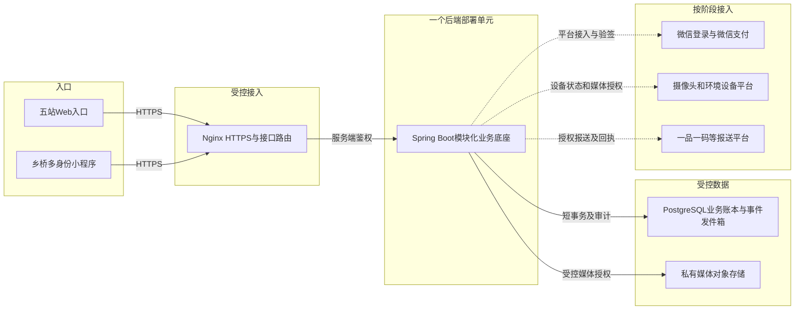

# 乡桥全栈架构：递归复查与建设基线 V1

日期：2026-10-06。依据用户全部业务设想及本地仓库代码，区分现状、已修复原型与目标架构。不是生产后端、支付或硬件上线证明；没有修改线上数据库。

## 1. 结论

推荐保留现有React/原生小程序和Java/PostgreSQL技术方向：**五个网站入口＋一个多身份小程序＋一套统一身份与业务底座＋按业务分模块的单体后端**。前期不按角色拆成11套后台，不按每个功能拆微服务。

主要缺口在可信业务后端和一致数据模型，而非网页数量。原型可以继续验收；生产上线必须先补多身份、对象授权、设备事件、独立验收、库存事务、财务账本及外部接入，不能仅把Mock URL改成真实域名。

“递归”在这里指有限的逐层检查并回查：目标 → 入口 → 模块 → 对象 → 状态 → 权限/证据 → 异常 → 跨模块回查。每层均检查正常、失败、撤销、重试、并发、越权六类情况。闭合标准是规则和验收用例覆盖，不是宣称找尽所有潜在缺陷。

## 2. 仓库现状：证据与差距

| 层级 | 已有证据 | 不能据此认定 |
| --- | --- | --- |
| Web | admin-web的React/Vite/TypeScript、多域构建入口、角色页面和本地状态机 | 真实统一账号、真实交易、跨账号协同已完成 |
| 小程序 | 原生9路由容器（新增帮助中心）、22共享业务模块、五Tab、多身份及可点击预览 | 微信正式登录、真机NFC/BLE、上传、摄像头、合同及付款已接入 |
| 后端 | backend/pom.xml包含Java21、Spring Boot、JDBC、PostgreSQL、Flyway；Application.java只有启动入口 | 已有业务Controller/Service/Repository、生产API或支付接口 |
| 数据库 | V1仅accounts、sessions、entities、idempotency、audit_events五表 | 单role＋单organization_id已经支持一人多主体多角色；通用data文本能替代核心账本 |
| 契约 | contracts/api-v1.md一期接口和fuan固定范围 | 新设备、成本、分账、跨中心业务已完整定义并实现 |
| 管理登录 | AuthContext调用api/mock.ts，固定演示验证码、Mock token前缀验证 | 真实短信、MFA、可信租户隔离或生产权限 |
| 官网/业务网关 | 上次发布记录记载五站演示；api、work、nc写接口仍有503占位边界 | 有效生产网关或本次新版本已发布 |

现有服务器可能有历史业务/反向代理，本次不能从Java骨架推断其全部运行情况。阿里云页已由用户登录，但自动读取仍超时；使用原来已核验的known_hosts检查SSH后返回无有效授权。未执行新上传、发布、数据库迁移或新密钥授权。

## 3. 入口和部署边界

| 入口 | 负责内容 | 禁止混入 |
| --- | --- | --- |
| nong.cloud | 乡桥农事中心、公司/业务介绍、成员与申请、准入执行标准、农事卡、各模块入口 | 私有农户档案、管理财务、真实业务秘密 |
| m.nong.cloud | 运营、资料核验、标准版本、设备、中心、支付商户、分账对账、接口审核和审计 | 只靠前端角色选择获得权限 |
| work.nong.cloud | 种植户、合作社、农资、农机、农服、植保、采购、冷库、分拣、机构、家庭代办 | 支付商户号、分账后台、其他主体私有档案 |
| nc.nong.cloud | 授权公开农场、真实设备状态、方案、认购、跟踪和售后 | 假直播、未确认价格和合同、原始GPS及私人成本 |
| api.nong.cloud | 现在：文档和本地沙箱；未来：明确分层的业务/开发者API入口 | 公开数据库、密钥、未授权后台管理接口 |
| 乡桥小程序 | AppID wx8e467f0ee6022a34；五Tab，一次登录、多主体角色 | 另建11套账号、小程序财务管理、AppSecret |

nongfu.tech弃用。五网站可以独立构建和发布，但不各建独立业务数据库。同一套账号的工作身份一次登录；管理财务属于额外授权和高风险会话，不能把“一次登录”扩张为全站管理权。

### 目标部署视图（待建设，不代表线上实测）

农事卡不是Wi-Fi终端：本地GNSS和物理按键采集，通过BLE/NFC与受控客户端衔接，再由手机上传。镜头直播使用独立媒体服务，不把视频帧塞进PostgreSQL，也不透传摄像头管理账号。初期不要求新增消息中间件或Redis；有测量到的负载、可靠性或多实例需求后再引入。

## 4. 身份递归：账号、主体、角色、授权不能合并

建议核心关系：

- Account：登录账号；Credential/ExternalIdentity：已核验微信、手机号等关联。
- Subject：个体农户、公司、合作社、服务队等业务主体。
- Membership：一个账号加入一个主体的成员关系，可关联有效期、状态。
- RoleGrant：成员关系下的业务角色和权限；同一成员可拥有多角色。
- Delegation：被代办人、代办人、对象、动作、期限、撤销状态；不是永久角色。
- OperatingCenter/ServiceArea：服务中心和地域覆盖；同县域不等于同主体或同数据权限。
- FinanceGrant：单独的财务操作/审核权限；BusinessRole不自动变成FinanceGrant。

当前身份为“成员关系＋角色授权＋可选代办关系”的有效组合。服务端先验证会话，再验证当前组合及对象归属；列表、详情、导出、文件、消息和写操作使用同一规则，不能只隐藏菜单。

种植户兼农服队、合作社兼农资商、农机兼植保、种植户兼消费者、子女代办兼本人种植户均无需重新注册。相同角色在两个主体下也应可切换。新增角色申请未审核不入可用身份；撤销/冻结后立即停止相应访问，离线草稿再上传时也需重新校验。

验收人与执行人按已核验自然人及业务利益关系判定独立性，不仅比较角色名称；同人两个账号也不能绕过。原型本轮只实现同账号拦截，正式端需可信自然人关联和独立复核流程，不能自行收集不必要身份资料。

Web生产会话建议采用受控HttpOnly会话及CSRF防护或经过审查的等价方案；小程序使用服务端发的短期会话。不得在各站复制长期管理员token，也不通过URL传登录凭证。第三方开发者接口使用独立应用身份、scope、撤销和速率限制，不复用人的管理员token。

## 5. 模块递归：共同底座，共享流程，按职责投影

| 模块 | 主要对象和写入负责人 | 输出 / 不能混同 |
| --- | --- | --- |
| 身份中心 | Account、Subject、Membership、RoleGrant、Delegation | 有效身份上下文，不由前端自授 |
| 地块产季 | Plot、BoundaryVersion、Season、CropChange、Forecast | 核准档案；GPS定位不证明权属 |
| 卡与事件 | Device、Binding、ConfigVersion、DeviceEvent、SyncReceipt | 原始事件与确认回执；不是已经核验的农事 |
| 农事记录 | Activity、LaborConfirmation、InputApplication、Evidence | 已确认作业；采购凭据不等于施用 |
| 服务履约 | ServiceRequest、WorkOrder、Fulfillment、Acceptance、Dispute | 共用农机/农服/植保状态机，专业字段扩展 |
| 农资与资源 | SaleReceipt、ReturnReceipt、Machine、Team、Facility、Telemetry | 凭据与能力；耗电不等于库存、停业或产量 |
| 土壤与成本 | Sample、LabReport、Advice、MarketQuote、CostSnapshot | 版本化报告/估算；建议不自动成为施肥指令 |
| 产销与库存 | Listing、Demand、Batch、StockLedger、Reservation、ProcessingRun | 成熟预测、权属、数量平衡；意向不等于成交 |
| 云农场 | FarmPublicView、CameraGrant、Plan、Subscription、Delivery、AfterSale | 单独的消费者公开视图，真实状态 |
| 商户与支付 | MerchantBinding、RuleSnapshot、Payment、Sharing、Return、Refund、Reconciliation | 服务端财务账本；只在管理后台管理 |
| 核验与报送 | StandardVersion、Assessment、RecordStatement、Submission、ExternalReceipt | 乡桥记录核验声明及报送回执；非官方绿色食品认证 |
| 公共支撑 | Attachment、Audit、Notification、Outbox、Idempotency；帮助中心SupportTicket、Assignment、CallbackRequest | 统一证据、消息和帮助受理；客服不自动获得业务/财务操作权 |

它们是同一后端中的模块，不是12个必须独立部署的服务。模块调用通过明确服务接口，不直接改别的模块的表。侧向回查特别关注：服务验收→农事；农事→成本；产季变更→成熟供货；入库→认购份额；退款→权益/库存/分账。

## 6. 数据递归：以业务账本替代万能entities

现有accounts.role和organization_id保留为遗留字段参考；未来追加可回滚迁移，建立成员及多角色关系，不在已有生产库直接改V1历史迁移文件。存量身份映射需经过核对，不按姓名自动合并账号。

核心业务建有类型的关系表，重要金额、数量、状态、外键、版本不能只塞到data文本。JSONB仅承载受控扩展字段，不能回避约束。每项业务记录保留主体、产季、有效权限范围、版本、采集时间、提交时间、操作者、代办关系和审计来源。

空间数据记录坐标系和转换版本；面积可用平方米存储、明确换算展示亩；农产品数量采用明确精度的kg账本，1kg=2斤。海拔记录来源及误差。预计、实测、核验三个维度分开，不因状态改动覆盖原值。

库存事件区分入库、出库、退货、损耗、加工转化；预留有独立有效期、取消及释放状态。货权主体和保管主体分开。可售量由同一服务端库存账本和有效预留计算，不能用多份前端数组各减一次。

金额用整数分或审查后的固定精度金额类型，禁止浮点财务账本。成本估算允许舍入展示，但应保存原始输入、行情日期/来源、产量口径、缺项、租金折旧服务等科目及版本，不把估算现金成本当成已支付额。

主体/角色授权、业务对象外键及高频检索维度需要对应索引，排序分页需稳定键。唯一约束用于设备事件去重、身份关系、业务幂等单号和支付回调。库存锁定与单需求唯一接单使用短事务、版本或条件更新；并发重试不得重复扣量。执行策略需结合实际隔离级别测试，不假定普通读写自动防超卖，参照[PostgreSQL事务隔离说明](https://www.postgresql.org/docs/current/transaction-iso.html)。

运行账号最小权限；对象授权在服务端实现，可结合RLS纵深防御。连接池中的身份上下文必须事务级设置并清理，避免复用连接串租户；不能用数据库超级用户或BYPASSRLS角色声称RLS已隔离，见[PostgreSQL行安全策略](https://www.postgresql.org/docs/current/ddl-rowsecurity.html)。

## 7. 状态递归：成功、撤销、失败重试均要闭合

| 链路 | 正常流程 | 关键阻断 / 异常 |
| --- | --- | --- |
| 成员申请 | 草稿→提交→核验→批准→有效成员/角色 | 材料不足、驳回、过期、撤销；申请不自动生效 |
| 地块作物变更 | 提案＋照片/视频→独立核验→新版本 | 缺证据不改正式档案；新版本使旧成熟预测/供货待复核 |
| 卡配置 | 平台目标版本→待下发→设备确认版本 | 保存不等于生效；拒收、断连、设备不兼容可重试 |
| 卡事件 | 本地保存→手机读取→服务器持久化→回执 | 无持久化不清设备数据；重传返回同一结果 |
| 农资 | 销售/退货凭据→农户实际施用确认→关联农事 | 买回家不等于已经施用；退货不抹掉已施用事实 |
| 服务 | 需求→唯一成交工单→接单→作业→完工待验收→独立验收 | 未开工可按规则取消；整改、争议不直接完成；执行人不得自审 |
| 检测 | 委托→采样封样→检测→报告提交→核验归档 | 采样、机构、核验职责分别留痕；更正追加版本 |
| 库存 | 入库→有效预留→交接出库 | 超卖阻断、过期释放、取消、损耗、退货隔离及加工数量平衡 |
| 消费 | 公开方案→意向→真实合同/订单→支付→生产/交付→验收售后 | 意向非合同；减产、取消、部分履约和退款分别处理 |
| 财务 | 支付确认→分账受理→异步结果→解冻核对→对账 | 验签、重复通知、部分失败、回退、部分退款和差异审核 |
| 报送 | 授权→预检→提交→受理回执→业务结果 | 本地导出、请求成功不等于外部平台已审核通过 |

旧契约强调公开市场自主接单，原型有固定服务方样例。将ServiceRequest与唯一WorkOrder分开：开放市场、定向邀约是需求渠道；正式产品默认策略待运营确认，不能把样例指派当作仅支持中心统一派单。

服务标准和评分规则冻结版本。作业事件可及时留存，只有独立验收才能标记“已验收服务”；不要把原始农事采集延迟到验收后才保存。系统完成率、用户评价和真实质量核验分别记录。

## 8. 硬件、定位、离线的闭环

硬件目标：身份证大小、不超过三倍厚度、五键、GPS/GNSS、BLE、NFC、指示灯、无Wi-Fi/震动/蜂鸣、至少月充电目标；20样机→1000→10000。均须实物验证，不能由UI确认。

建议按键触发采集时间和定位，保存精度/定位耗时/来源；定位失败保留事件但不伪造坐标。与测绘边界匹配失败、邻地歧义或超出精度门限进入中心/农户协助确认，不按“最近一块地”强制归属。温室、随身遮挡等场景纳入样机实测。

设备事件唯一标识至少包含device_id、不可重复的设备启动/序列上下文、事件序号；保存采集时配置版本和绑定版本，设备时钟/服务器时间分别留存。未知版本不按当前A/B/C含义猜测历史作业；挂失、换绑、补卡与旧事件上传必须有明确归属核验。

BLE读取后手机可以本地受控暂存；服务器持久化后才回执设备。离线许可的范围、有效期及撤销冲突由服务端重新验证，不能以“以前授权过”跳过权限。手机无网、App关闭、卡断电、上传丢包、回执丢失、重复上传均列为工程验收用例。

NFC先作为卡片身份识别和授权交易关联；实际可读数据、安全能力及手机系统兼容性须协议与真机验证。UID/贴卡/手输卡号都不是权限凭据，也不是付款、验收或完整农户档案授权。大量事件同步优先BLE，NFC能力由卡片方案确定，不提前保证全部手机支持。

## 9. 消费、会员、成本和分账交叉复查

农户记录平台费0；卡片办卡、补卡100元/张；真实农资、农服、商品另约。消费者平台服务费0，不代表产品或配送免费。采购会员/按条收费待确认，一般999以内是讨论口径，不作为永久的生产定价约束。

成本用确认出工人天、实际施用及行情估算；多人总人天可超过366。完整成本包含已输入的劳动估值及成本项，缺项明示；×1.35表示加价35%，不是毛利率35%，也不是核实的某零售企业收购规则或强制保底价。

卡费、会员权益费、服务商工具费、自营产品收入、平台约定商家服务费分科目核算。卡业务身份和支付商户不是一一对应，消费者或农户无需为了一个角色开支付商户。

已有服务商及中心特约商户的开通情况，不等于本平台已获接口授权。中心真实销售订单由其对应商户收款，乡桥按合同及授权接收方规则分取费用。校验订单累计上限、剩余待分额、手续费、退款及规则版本；本地“订单额－服务费”非结算净额。分账不等于提现；分账后退款需核实回退权限与流程。依据[微信支付官方分账常见问题](https://pay.wechatpay.cn/doc/v3/partner/4014547107)。细节见《乡桥商户与分账管理-2026-10-06.md》。

## 10. 接口与可靠性

保留/api/v1响应信封、traceId、错误码、分页及幂等约定，新增范围以契约草案标注，不伪称接口已可调用。按受众分public、subject、admin、device-sync、developer、webhook路由及权限；公开农场摘要可匿名读取，私人记录必须授权，不能沿用“登录之外全部认证”导致公开浏览被迫登录。

客户端选身份传入关系ID，服务端查其有效归属；不能凭tenantId、countyCode或role字符串选择数据库或扩大权限。后台可在已授范围跨主体复核，但需要额外权限和审计，不默认“运营员看全国一切”。

业务事务和审计/待发事件一起持久化；外部支付、通知、报送和设备回执不在长数据库事务中等待。异步消费者允许至少一次投递，以幂等实现业务结果只记一次，不承诺跨系统天然exactly-once。失败保留可重试、人工处理及对账状态；事件发布可靠性可参考[Spring模块化应用事件机制](https://docs.spring.io/spring-modulith/reference/events.html)，不表示仓库已接入该依赖。

附件私有存储、短期访问授权、类型/大小/恶意文件检查；图片视频不能只凭文件名认定真实。地图、报告和故事输出分别脱敏和授权。会员退费/权益撤销后重新验证查看权限，不让前端缓存成为永久授权。

## 11. 运维、迁移与验证

开发、测试、演示、生产明确区分；Mock token和固定验证码不能被生产识别。现有安全版本及依赖需上线前核查；本稿不把骨架中的版本当作当前推荐版本。

每站构建产物、配置、证书、API路由与业务数据分别备份；发布用校验包与原子版本切换。只回滚前端不一定能回滚数据库；数据库采用追加迁移、演练、兼容期和恢复验证，不直接改已应用V1。保持现有backend代理、TLS和nong.cloud历史接口，不开放新端口。

监测认证拒绝、跨主体访问、同步积压、重复事件、定位待确认、验收争议、库存负数、支付差异、失败报送和摄像头离线；日志不记录密钥、身份证、支付明文或完整定位。备份可用性要通过恢复演练验证。

P0安全门：多身份对象授权与撤销、同人自审阻断、设备重传去重、缺证据阻断、库存并发和金额守恒、支付验签/幂等、隐私公开边界。不通过这些测试，即使页面能打开也不作为正式业务上线。

## 12. 执行顺序和停止条件

| 阶段 | 优先交付 | 验收闸口 |
| --- | --- | --- |
| A：契约统一 | 身份/主体/产季/事件/工单/批次ID、枚举、权限、标准版本、公开视图 | PC与小程序对同一对象得出相同业务结果 |
| B：可信P0后端 | 登录、多身份、授权、地块、设备绑定/事件、农资凭据、服务、独立核验、附件和审计 | 20样机及断网重传、对象授权、双身份自审测试 |
| C：产业交易 | 成熟供货、采购、自营收购、共享库存/分拣、土壤成本、中心支付商户 | 库存并发、数量/金额平衡、独立财务审核与渠道联调 |
| D：云农场 | 真摄像头授权、方案合同、认购订单、交付售后 | 实际经营主体/设备/产品/合同齐全；无假直播或虚假履约 |
| E：复制与数据服务 | 中心模板、跨县授权、汇总数据、外部报送 | 授权、标准可移植性、运营单位经济和真实样板验证 |

500亩首年样板、第二年1000用户、第三年复制仍是规划；补贴和绿色食品标识是需要单独资质、申报和核验的项目，不能用前端记录自动兑现。可争取项目清单另册保留，不以预期补贴覆盖未经验证的运营成本。

本轮已修复原型：同账号切换角色仍不能自验收；PC工作台演示缓存按账号隔离；人天与0–100%参考加价一致及安全金额检查；异步意向确认检查身份；申请下拉和地址换区清乡镇；配置目标/设备版本分离；农场消息渲染兼容；分账只在管理后台并明确非执行额度；管理登录取消“可信租户隔离”的误导表述，仓库说明取消“只切换Mock即可上线”的表述。

仍待工程建设：可信自然人/对象权限、Java业务模块、关系表迁移、真实媒体和设备、跨端共享后台、并发账本、支付/合同/报送、全国地址库、真机及生产安全验收。本轮不把这些目标登记为已完成。

## 13. 递归不等于权限自动继承

四种关系必须独立：行政地域树、中心服务网络、业务主体成员关系、支付商户绑定。一个地块处于某县，不能推导该县全部商户有查看权；子中心加入平台，不能推导平台普通员工有所有财务权。经营主体可能跨中心服务，地块档案仍保持稳定ID，变更服务中心不迁走或重建整套生产历史。

行政区、组织树和地块子分区需要防循环、防无限深度；跨层查询须在服务端限定深度、范围和分页。上级权限是否覆盖下级由明确授权策略决定，不由字符串前缀或父子名称判断。多个主体共用一个冷库或地块时，资产所有人、实际生产人、保管人和受委托人分别建关系，不复制出多份独立真相。

账号删除/撤销授权不应删除已履约合同、检测报告、库存或财务历史。合法保存期与个人信息删除要求须分别确定；公开展示、营销故事和代办授权可以撤回，保留必要审计不等于可以持续公开。

## 14. 各端必须共用的对象基线

| 稳定对象 | 必须关联 | 版本 / 不可变信息 |
| --- | --- | --- |
| 地块 | 生产主体、边界、中心服务关系 | boundaryVersion与坐标系；产季另建，不覆盖多年作物历史 |
| 产季 | plotId、cropId、经营主体 | cropVersion、预测来源与测算时间；估产不等于可售库存 |
| 设备事件 | deviceId、bindingVersion、configVersion、序列上下文 | 原始按键/时间/精度留存；纠正以关联补充记录表达 |
| 农事记录 | 产季、原始来源、劳动/实际农资 | 确认人、证据、核验状态；原始、补录、核验分层 |
| 服务工单 | 需求、委托/执行主体、产季 | 标准快照、履约、独立验收、争议历史 |
| 产品批次 | 产季、货权人、等级、检测引用 | 数量单位、等级版本、加工输入/输出关系 |
| 消费订单 | 真实销售主体、方案/批次、履约与支付单 | 合同/价格快照；平台意向ID不能冒充订单ID |
| 支付及分账 | 业务订单、中心特约商户、渠道交易单 | 原始确认金额、规则快照、累计成功/处理中金额、退款回退 |
| 核验声明 | 记录范围、产季、证据、标准版本 | 有效期、复核/撤销、更正历史；不冒充法定产品认证 |

成熟图公开授权的作物、规模和预期时间，会员/按条权限用于约定的信息服务。联系电话、可售精确数量、精确边界是否展示应分别授权，不能把“购买一次信息”扩大为可无限导出原始数据。数据服务优先提供授权汇总与分析，不出售未授权农户隐私；农户记录平台费为0不能成为默认同意商业数据处理的依据。

申请补贴是中心经营管理中的项目台账：项目政策版本、申报主体、资格材料、支出凭证、验收、到账记录分开。规划补助与已到账收入分开；提交记录不能自动形成“符合资格/必能获补贴”。具体可申报政策仍按独立政策清单和当期通知核验，本稿没有重新认定项目资格。

## 15. 跨模块回查用例：按同一事实递归验证

以下是待建设后端的验收用例，不是本轮已通过的集成测试。

| 情景 | 必须一致的结果 | 涉及模块 |
| --- | --- | --- |
| 一人既种植又提供农服，切换身份或另一个账号 | 能合法执行业务，但不能验收自己的同一服务；独立复核可恢复闭环 | 身份、服务、核验、审计 |
| 地块从葡萄改种其他作物 | 材料核验后新版本生效；旧成熟供货/农场方案待复核；已签合同进入风险处理而非静默改品 | 地块、成熟、库存、农场、合同 |
| A键改义后上传断网旧记录 | 使用采集时版本解码；未知版本待确认；重传不多记出工或扣料 | 设备、农事、成本 |
| 买肥料后退货或实际分次施用 | 销售凭据可冲正；实际施用按证据确认；库存/成本各遵循自身账本 | 农资、农事、库存、成本 |
| 两个采购商同时买最后一批货 | 服务端仅允许有效可售量被占用；失败订单不扣量不生成履约权益 | 采购、库存、支付 |
| 农场认购减产、部分交付、部分退款 | 权益、数量、已收款、退款与分账回退分别核对；历史生产事实不被改写 | 农场、订单、库存、财务 |
| NFC贴卡人不在授权范围 | 不泄露完整农户档案，不产生付款/验收，仅进入拒绝或申请授权流程 | 卡、身份、农资/服务 |
| 子女授权过期、角色冻结、会员退费 | 私有页面、下载、消息附件和离线重新上传一并拒绝或转人工确认 | 身份、全部对象、消息、文件 |
| 中心耗电增加但没有库存更新 | 只能更新活动线索，成熟规模/可售库存不得凭电表自动增加 | 资源、遥测、库存 |
| 一品一码请求返回受理，但最终被驳回 | 保留回执和原因；不标记已审核通过；修正再报不重复产生生产事实 | 核验、报送、审计 |

每发现一项问题，都回到上层更新规则、契约、页面文案和测试；然后再从受影响的相邻模块复查。满足：对象归属明确、状态可解释、数量/金额守恒、证据可追溯、异常可恢复、权限可撤销，才关闭该问题。还没有后端实现的用例只能关闭“设计冲突”，不能关闭“工程缺口”。

## 16. 需要定版而不能由样例猜出的运营规则

1. 服务需求默认开放接单还是定向邀请，以及争议时独立验收人员范围。
2. 实际销售合同主体与订单收款商户的对应关系、商家服务费/分账协议、退款责任。
3. 乡桥记录核验声明的等级、证据门槛、有效期与复核责任人。
4. 采购会员/按条收费、查看权益与信息授权边界，不能因“一般999以内”固定全部产品。
5. 云农场减产、品质差异、交付及售后方案；没有真实摄像头和地块材料前仅演示。

已定政策无需再问：五域名分工、弃用nongfu.tech、小程序多身份、财务放管理后台、农户平台费0、卡片办补各100元、硬件不加Wi-Fi。

另列原型遗留项：旧后台行政区样例含不准确乡镇和演示编码，不能用作正式行政字典；管理演示会话恢复尚需异常存储与撤销竞争用例；全国乡镇、跨端协同和服务端自然人独立性未实现。正式接入前以可信行政区数据与服务端规则替换，不能把本地样例自动迁入生产。

## 17. 新增统一帮助中心 / 呼叫受理中台

在既有公共支撑模块内增加，不另建网站、账号或一套数据库。小程序与PC工作台面向种植户和服务主体，云农场面向消费者，管理后台提供中心受理队列；各入口未来使用同一个SupportTicket。多身份下工单绑定账号＋经营主体＋角色/代办上下文，切换角色不泄露其他身份的私有求助内容。

目标流程：登记→受理/分派→处理中→回复待用户确认→确认关闭；未解决可重开，争议另走独立业务复核。回访意向、约定回访时间、实际通话结果分别记录，不能把点击“电话回访”记成已完成通话。真实热线、排班、服务时限、电话平台和授权均待配置。

帮助对象可关联地块、产季、设备、服务工单、批次或消费订单；关联不授予客服无限查看权。坐席只看当前中心及已授权工单的必要资料，不能自授财务权限、修改原始农事、代替用户签约、验收、改库存、退款或分账。升级专业人员不自动改变业务核验结果。

农户和消费者不收平台帮助服务费；现场农技、检测或实际服务若有约定费用，须另行明确并取得确认，不能由帮助工单隐式收费。前期可由中心客服兼任分派，按卡片/账号、农技检测、服务履约、产销仓储、消费者售后形成处理队列，待实际需求验证再接入电话系统。

本次已有界面：9路由小程序帮助页，PC工作台共用帮助入口、农场消费者帮助页、管理后台“帮助呼叫中心”演示队列。当前均是本地独立原型，不是跨端客服系统，也没有真实电话。详细边界与建设项见《乡桥帮助中心与呼叫中台-2026-10-06.md》。
